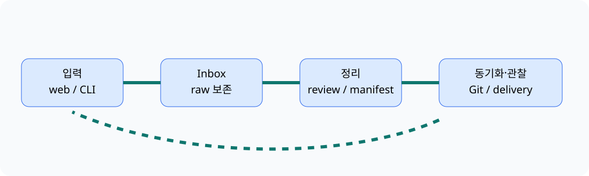

# 제2의뇌 자동화 — 관찰 가능한 지식 루프


기준일: 2026-10-04 (KST)

Markdown과 Git을 원본으로 삼아, 흩어진 입력을 보존 가능한 Inbox로 모으고 상태 기반 triage, 일정·프로젝트·기회 보기, 주간 검토, retention, 오류 관찰까지 연결한 개인 지식 시스템의 공개 포트폴리오입니다. 원본 노트·개인 일정·토큰·운영 주소는 제외했습니다. AI Reading Time 파이프라인은 근거 수집·중복 제거·승인·편집·자산 렌더링까지의 게시 전 준비 단계이며 자동 게시가 아닙니다.



## 이 프로젝트에서 실제로 만든 것

- `capture.py`는 raw text를 안전한 Markdown note로 만들고 중복 파일명을 피합니다. 본문은 앞뒤 `.strip()`만 적용하며 여러 줄을 허용합니다. Telegram 접두사 파서는 접두사·문장에서 category/area/tag를 추론하며, live handler 연결은 미확인입니다.
- Web form/queue, Inbox triage, KST dashboard, calendar 입력, project manifest/Kanban, weekly review, Trash retention, opportunity refresh를 각각 독립된 흐름으로 기록했습니다.
- Git 작업은 lock → pull → 변환 → `git rm`을 포함한 stage → commit/push → 외부 상태 처리 순서를 지향합니다. 이 fail-closed 수선은 2026-10-04 기준 로컬 미커밋·미배포 상태이며, 완성된 릴리스나 분산 원자성을 주장하지 않습니다.
- 사용자는 목표·통합 방향·운영 판단·검증 기준을 정했고, AI는 조사 정리와 구현 초안을 보조했습니다. 모든 줄을 사용자가 직접 손코딩했다고 주장하지 않습니다.

## 대표 문제와 해결

1. KST 자정과 브라우저 현지 시간의 이중 보정은 `Intl.DateTimeFormat` 기반 날짜 계산과 UTC date-parts 산술로 분리했습니다.
2. Quartz SPA 이동에서 script가 재실행되지 않던 문제는 `nav` hook과 idempotent binding으로 보완했습니다.
3. queue 파일 삭제는 `git rm`으로 push 전에 stage하고 로컬 commit하며, push 성공 때만 원격에 반영됩니다. push가 실패하면 로컬 commit/working tree는 남아 재조정이 필요하고 rollback은 입증하지 않았습니다. 외부 Issue 종료는 push 성공 뒤에만 수행합니다. 이 수선은 2026-10-04 기준 로컬 미커밋·미배포 상태이며 분산 원자성은 보장하지 않습니다.
4. 2026-10-04 기준 원래 운영 배포 workflow는 현재도 `npm run verify || true`로 검증 실패를 무시하며, 이는 미해결 품질 위험입니다. 이 공개본의 예제 CI/검증 명령만 실패를 전파하도록 구성했습니다.

## 읽는 순서

- [구조와 범위](docs/architecture.md) · [자동화 목록](docs/automations.md) · [사고 목록](docs/incidents.md)
- [운영 계약](docs/operations.md) · [출처와 기여 경계](docs/provenance.md) · [개인정보 경계](docs/privacy.md) · [현재 한계](docs/limitations.md)
- [검증 방법](docs/verification.md) · [유지보수](docs/maintenance.md)
- [사례: 시간대](docs/case-studies/timezone.md) · [SPA/정적 자산](docs/case-studies/spa-assets.md) · [Git 경계](docs/case-studies/git-transactions.md) · [품질/보안](docs/case-studies/quality-security.md) · [AI 읽을거리 파이프라인](docs/case-studies/evidence-pipeline.md)

## 실행

Node.js 22+와 Python 3.11+만 필요합니다. `capture` 예제는 `--root`가 필수이며 지정한 디렉터리 아래 `content/Inbox`에만 씁니다; 임시 디렉터리 사용을 권장합니다.

```bash
python3 scripts/verify.py
npm test
python3 examples/capture.py "Synthetic parser contract" "raw technical example" --root /tmp/sba-demo
```

## 결과와 한계

이 공개본은 원본 운영 저장소의 복사본이 아니라, 근거를 보존한 안전한 로컬 예제와 문서입니다. 실제 Gateway/Worker/Pages/Quartz 배포, 스케줄러 효과, 메시지 전송, Meta/Instagram OAuth·게시 연동은 재검증하거나 구현하지 않았습니다. 역사적 HMAC 설계와 현재 authorization boundary의 불일치도 보안 제품 템플릿으로 제시하지 않습니다. `localStorage` 완료 상태는 브라우저별이며 서버 동기화가 아닙니다.

새 작업물에 임의의 permissive license를 부여하지 않습니다. Quartz upstream MIT와 외부 구성요소의 출처·라이선스 경계는 [출처와 기여 경계](docs/provenance.md)에 적었습니다.
