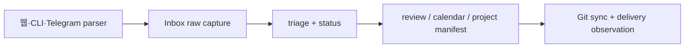

# 구조와 책임 경계

기준일: 2026-10-04 (KST). 입력 캡처 → Inbox 원문 보존 → 상태 기반 정리 → 일정·프로젝트·기회 파생 보기 → Git 동기화와 전달/사고 관찰의 순서다.

원본은 Markdown과 Git이다. web queue와 calendar write는 입력 계층, dashboard는 KST date utility, 완료 체크는 browser `localStorage`를 사용한다. localStorage는 서버 동기화가 아니다. 공개본은 운영 source snapshot이 아니라 pure/local-only 예제다.

근거가 있는 범위는 raw capture, CLI parser, queue/Inbox ingest, dashboard/calendar, manifest/Kanban, weekly review, Trash retention, opportunity renderer/refresh, lock·dedupe·dry-run 패턴이다. durable reminder, automation log, live Gateway/Pages/Quartz 검증은 계획 또는 미확인이다.
